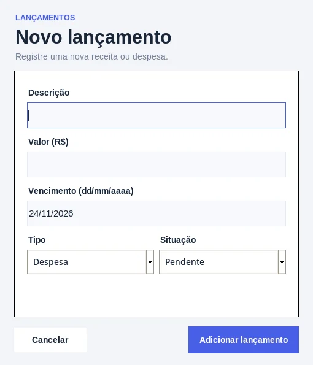
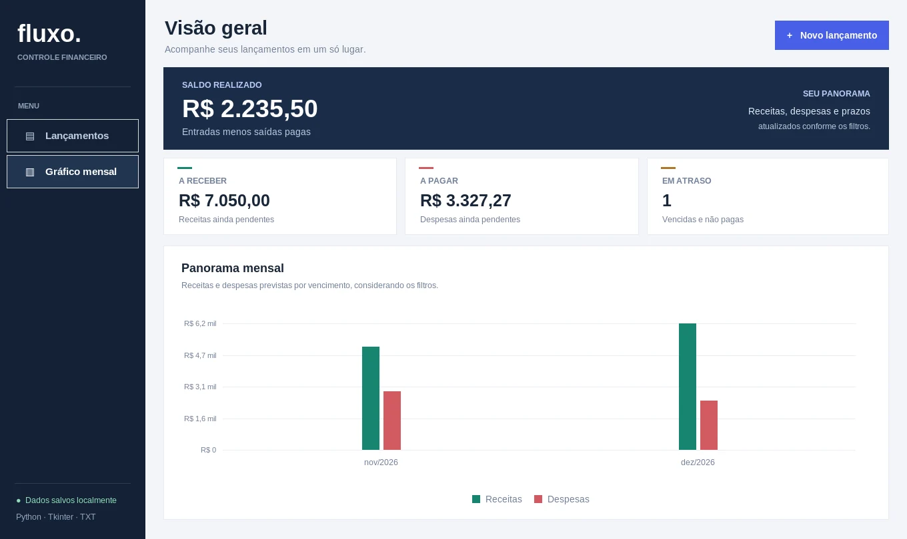

# fluxo.

**Contas a pagar e receber, em um aplicativo desktop simples e organizado.**

O **Fluxo** é um projeto de programação em Python que permite registrar receitas e despesas, acompanhar vencimentos e visualizar a situação financeira sem depender de internet, planilhas ou cadastro em uma plataforma. A interface foi feita com **Tkinter**; os lançamentos são guardados no próprio computador, em um arquivo TXT.


> **Quer testar?** A primeira execução já abre com **18 contas fictícias de novembro e dezembro de 2026** para conhecer a interface. São apenas exemplos, que podem ser editados ou excluídos.

## O que você consegue fazer

- **Registrar receitas e despesas:** criar, editar, excluir e marcar lançamentos como pagos ou pendentes.
- **Acompanhar a situação:** saldo realizado, valores a receber e a pagar, além de contas vencidas.
- **Encontrar lançamentos:** busca por descrição, filtros por tipo, situação e mês, e ordenação por coluna.
- **Visualizar o histórico:** gráfico mensal de receitas e despesas, desenhado no `Canvas` do Tkinter.
- **Exportar um relatório:** salvar a tabela filtrada em `.csv`, para abrir no Excel.
- **Usar offline:** todos os registros ficam no `contas.txt`, sem banco de dados nem dependências externas.

### Conheça as telas

| Criar ou editar um lançamento | Ver receitas e despesas por mês |
| :---: | :---: |
|  |  |

**A edição não bloqueia o cadastro:** você seleciona uma conta e clica em **Editar** (ou dá dois cliques na linha). Depois de salvar, a janela fecha e o botão **Novo lançamento** já fica livre para o próximo registro. Os botões de editar, pagar e excluir aparecem próximos da lista.

## Como baixar e executar

**Requisitos:** Python 3.8 ou mais recente, com Tkinter. No Windows, ele normalmente já está disponível na instalação do Python. **Não precisa executar `pip install`.**

1. Clique em **Code → Download ZIP** no topo deste repositório e extraia o arquivo. Se preferir, clone com `git clone https://github.com/palomagl/projetos-contas-gui.git`.
2. Abra a pasta extraída no **PyCharm** (ou no seu editor de preferência).
3. Execute o arquivo **`main.py`**. Também dá para iniciar pelo terminal, dentro da pasta do projeto:

```bash
python main.py
```

No Windows, se `python` não funcionar, experimente `py main.py`. Caso o PyCharm esteja apontando para um interpretador antigo, rodar pelo terminal é uma alternativa.

### Dados de demonstração e dados pessoais

Na **primeira execução**, se ainda não existir o arquivo `contas.txt`, o programa cria um automaticamente a partir de `docs/exemplo_contas.txt`. Depois disso, **não substitui um arquivo existente**, mesmo que ele esteja vazio. O arquivo de dados está no `.gitignore` para não publicar suas contas no GitHub.

Se quiser voltar à demonstração, feche o programa e copie o conteúdo de `docs/exemplo_contas.txt` para o `contas.txt` (faça uma cópia de segurança antes, se tiver informações suas). Para começar com a lista vazia, deixe `contas.txt` vazio.

## Tecnologias e organização

| Parte | Tecnologia |
| --- | --- |
| Aplicação e interface | Python 3.8+, Tkinter e ttk |
| Regras financeiras | Listas, tuplas, dicionários e funções Python |
| Salvamento | Arquivo local `.txt`, com gravação atômica |
| Gráfico | Tkinter `Canvas` |
| Testes | `unittest` (biblioteca padrão) |

```text
projeto_contas_gui/
├── main.py                      # ponto de entrada
├── services/
│   └── finance_manager.py       # CRUD, validações, cálculos, filtros e TXT
├── views/
│   └── app_gui.py               # interface e gráfico
├── docs/
│   ├── img/                     # capturas reais do aplicativo
│   ├── exemplo_contas.txt       # dados fictícios nov/dez 2026
│   └── estrutura_dados.md       # documentação para a disciplina
└── tests/
    └── test_finance_manager.py  # testes das regras de negócio
```

Para executar os testes:

```bash
python -m unittest discover -s tests -v
```

**Atalhos:** `Ctrl+N` novo lançamento · `Ctrl+F` busca · `Enter` salva o formulário · `Esc` fecha o formulário · `Delete` exclui a conta selecionada.

---

Projeto acadêmico desenvolvido para a disciplina de **Programação em Python**. As imagens e os lançamentos apresentados são fictícios e foram criados para demonstrar a aplicação.
