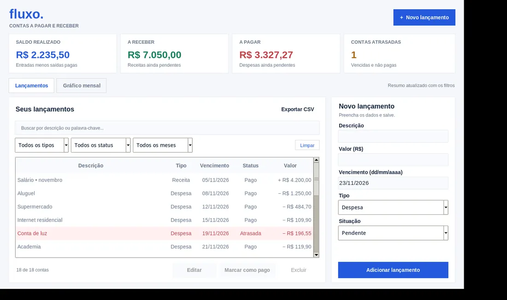

# Fluxo. — Contas a Pagar e Receber

**Um controle financeiro desktop, simples de usar e feito inteiramente em Python.** Cadastre receitas e despesas, acompanhe vencimentos e entenda quanto já entrou, quanto saiu e o que ainda falta pagar ou receber — em uma interface clara, sem planilhas complicadas.



> **Experimente sem configurar nada:** na primeira execução, o Fluxo carrega exemplos fictícios de **novembro e dezembro de 2026**. São lançamentos para demonstração, não dados reais. Você pode editar, excluir e adicionar suas próprias contas.

## O que dá para fazer

| Recurso | Na prática |
| --- | --- |
| **Visão geral** | Saldo realizado, valores a receber/a pagar e contas atrasadas |
| **Lançamentos** | Criar, editar, excluir, marcar como pago ou reabrir |
| **Organização** | Busca sem distinção de acentos, filtros por tipo, situação e mês, ordenação nas colunas |
| **Gráfico mensal** | Comparar receitas e despesas previstas em cada mês |
| **Exportação** | Gerar relatório `.csv` para abrir no Excel |
| **Dados locais** | Informações salvas automaticamente em `contas.txt`, sem conta online nem banco de dados |


## Baixar e executar

**Requisitos:** Python 3.8 ou superior, com Tkinter (normalmente incluído no instalador do Windows). Não é necessário `pip install`.

1. Clique em **Code → Download ZIP** neste repositório e extraia a pasta; ou clone com `git clone https://github.com/palomagl/projetos-contas-gui.git`.
2. Abra a pasta no **PyCharm** (ou outro editor) e configure um interpretador Python.
3. Execute `main.py` pelo botão **Run** ou pelo terminal:

```bash
python main.py
```

No Windows, caso `python` não seja reconhecido, execute `py main.py`.

### Dados de demonstração e dados pessoais

- Na **primeira execução**, se não existir `contas.txt`, o sistema copia os exemplos de `docs/exemplo_contas.txt` para o arquivo local.
- Se `contas.txt` já existir, **ele nunca será substituído por exemplos**, mesmo que esteja vazio.
- Para começar do zero, feche o aplicativo, abra `contas.txt` ao lado de `main.py` e apague seu conteúdo (mantenha o arquivo vazio).
- Para voltar à demonstração, feche o aplicativo e copie o conteúdo de `docs/exemplo_contas.txt` para `contas.txt` (faça um backup antes se tiver dados reais).
- O `contas.txt` está no `.gitignore` para impedir o envio acidental de lançamentos pessoais ao GitHub.

## Uso rápido

**Novo lançamento:** preencha os campos à direita e clique em **Adicionar lançamento**. Para editar, selecione uma linha e clique em **Editar** (ou dê dois cliques); depois de salvar, o formulário fica livre para uma nova conta. Um clique simples na tabela **não inicia a edição**.

Use a busca e os filtros para encontrar registros. Para pagamentos, selecione a conta e escolha **Marcar como pago**. O saldo realizado considera somente receitas recebidas e despesas pagas; valores pendentes aparecem separadamente. Os indicadores e o gráfico acompanham os filtros aplicados.

**Atalhos:** `Ctrl+F` pesquisar · `Enter` salvar no formulário · `Esc` novo lançamento/cancelar edição · `Delete` excluir a conta selecionada na tabela.

## Tecnologias e organização

- **Python 3.8+** e **Tkinter/ttk**: interface nativa, sem dependências extras.
- **Listas, tuplas e dicionários**: gerenciamento dos lançamentos em memória.
- **TXT local**: persistência com gravação atômica, sem banco de dados.
- **Testes `unittest`**: validação, cálculo, filtros e persistência.

```text
projeto_contas_gui/
├── main.py                   # inicia a aplicação e prepara exemplos no primeiro uso
├── views/app_gui.py          # tela, formulários e gráfico Canvas
├── services/finance_manager.py  # regras, filtros e arquivo TXT
├── docs/
│   ├── img/                 # capturas da aplicação
│   ├── exemplo_contas.txt   # lançamentos fictícios nov/dez 2026
│   └── estrutura_dados.md   # explicação para a disciplina
└── tests/test_finance_manager.py
```

Para rodar os testes:

```bash
python -m unittest discover -s tests -v
```

> Projeto acadêmico de **Programação em Python**, desenvolvido para exercitar operações CRUD, estruturas de dados, persistência local e construção de interfaces. As capturas acima apresentam dados fictícios.
